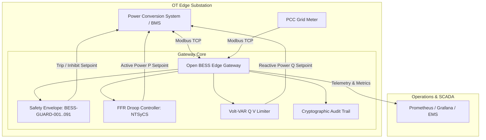

# Open BESS Edge Gateway

[](https://opensource.org/licenses/Apache-2.0)
[](https://www.python.org/)
[](https://github.com/bess-solutions/open-bess-edge/actions)
[](https://github.com/astral-sh/ruff)
[](https://mypy.readthedocs.io/)
[](https://github.com/PyCQA/bandit)

**English** | [Español](README.es.md)

Deterministic industrial edge gateway for Battery Energy Storage Systems (BESS). Operates locally at the substation/plant level between battery inverters (PCS / BMS) and higher-level SCADA / EMS networks. Implements a fail-closed safety envelope, NTSyCS-compliant Fast Frequency Response (droop / FFR <500 ms), and Volt/VAR reactive power support over industrial Modbus TCP.

> **Engineering Status.** Validated against industrial emulators, real loopback TCP network sockets, and an independent Modbus verification harness. Pending physical bench homologation with commercial inverter hardware (formal benchmark: 72-hour continuous test on physical PCS hardware satisfying FFR <500 ms and zero spurious safety trips). Detailed roadmap: `PROJECT_STATUS.md`.

---

## Architecture Overview



---

## Quick Start

### Installation

```bash
# Install package or development environment
pip install .
# or for full development & test tools:
pip install -e ".[dev]"
```

### Run Simulation & Diagnostics

```bash
# Execute complete local simulation (plant model + Modbus TCP server + edge node + 49.65 Hz contingency)
open-bess-edge simulate

# Validate production YAML configuration
open-bess-edge check-config config/edge_config.yaml

# Run the edge gateway service
open-bess-edge run --config config/edge_config.yaml

# Inspect vendor register profiles
open-bess-edge profile-info open_bess_edge_reference

# Cryptographically verify the local audit trail
open-bess-edge verify-audit /var/lib/open-bess-edge/audit.jsonl
```

---

## Universal Physical Convention

Strictly uniform across all codebase layers, algorithms, and drivers:
* **Active Power (P):** `+` = discharge / grid injection; `−` = charge / grid import.
* **Reactive Power (Q):** `+` = capacitive (injects VAR, boosts local voltage); `−` = inductive (absorbs VAR, lowers local voltage).

Vendor-specific conventions are normalized entirely within register profiles via explicit `sign` and `factor` bindings.

---

## Deterministic Control Loop

```text
Telemetry Acquisition (Modbus) 
  → Safety Envelope Evaluation 
  → Frequency Droop / FFR Calculation 
  → Volt/VAR Reactive Power Support 
  → P-Q Capability & Rate Limiting 
  → Setpoint Dispatch (+Write Verification) 
  → Watchdog Heartbeat Service 
  → Append-Only Audit Logging
```

### Verified Runtime Invariants (278 Canonical Tests)
* **Zero Initial Output:** Starts strictly at 0 kW, requiring `startup_valid_cycles` consecutive clean telemetry frames before releasing control.
* **Fail-Closed on Telemetry Loss:** Retains setpoint for a configurable window (`comm_loss_hold_s`, default 2.0 s); if timeout expires, forces setpoint to 0 kW immediately and retries until verified.
* **Strict Sensor Plausibility:** Any NaN, infinite, absent, or out-of-physical-range telemetry forces 0 kW instantly.
* **Latched Trip Discipline:** Safety trips latch shut. They cannot be cleared by transient condition recovery, requiring an explicit reset call once telemetry clears hysteresis thresholds.
* **Truncation Toward Zero:** Numerical bounds truncate setpoints toward zero; register boundary overflows raise exceptions rather than wrapping around.
* **Unbreakable Control Execution:** Runtime exceptions in non-critical tasks never crash the control thread; the node transitions to `SAFE_STATE` and logs audit events.

---

## Safety Guards (Safety Envelope)

| Code | Condition | Immediate Action |
|---|---|---|
| BESS-GUARD-001 | Critical Cell Undervoltage | Latched Trip to 0 kW |
| BESS-GUARD-002 | Critical Cell Overvoltage | Latched Trip to 0 kW |
| BESS-GUARD-003 | Cell Overtemperature | Latched Trip to 0 kW |
| BESS-GUARD-004 | DC Insulation Resistance Fault | Latched Trip to 0 kW |
| BESS-GUARD-005 | Cell Voltage Imbalance Exceeded | System Warning |
| BESS-GUARD-006 | High Cell Operating Temperature | 50% Thermal Derating |
| BESS-GUARD-007 | Low Cell Operating Temperature | Inhibit Charging (0 kW if P < 0) |
| BESS-GUARD-008 | DC String Voltage Out of Envelope | Latched Trip to 0 kW |
| BESS-GUARD-009 | High Ambient Enclosure Temperature | 50% Thermal Derating |
| BESS-GUARD-010 | State of Charge (SOC) Limit Reached | Directional Inhibit (Charge or Discharge) |
| BESS-GUARD-020 | Grid Frequency Outside Emergency Envelope | Trip / Alarm (Configured Thresholds) |
| BESS-GUARD-021 | Grid Voltage Outside Operating Limits | Trip / Alarm (Configured Thresholds) |
| BESS-GUARD-090 | Required Safety Telemetry Missing or Stale | Output Clamped to 0 kW |
| BESS-GUARD-091 | PCC Grid Meter Telemetry Stale or Dropped | Output Clamped to 0 kW |

---

## Device Profiles (`registry/`)

A device profile authorizes **control** mode only if it provides full active power setpoint capabilities and binds all required safety signals. Commercial vendor profiles are categorized as **monitor** mode at `unverified` tier until validated on physical hardware benches.

| Profile | Mode | Tier | Notes |
|---|---|---|---|
| `open_bess_edge_reference` | control | reference | Canonical project register map with active/reactive control |
| `huawei_sun2000` | monitor | unverified | Register bindings derived from manufacturer technical documentation |
| `sma_sunny_tripower` | monitor | unverified | Register bindings derived from manufacturer technical documentation |
| `fronius_gen24_byd` | monitor | unverified | Register bindings derived from manufacturer technical documentation |
| `solaredge_storedge` | monitor | unverified | Register bindings derived from manufacturer technical documentation |
| `victron_multiplus2` | monitor | unverified | Register bindings derived from manufacturer technical documentation |
| `open_bess_edge_meter_reference` | monitor | reference | Point of Common Coupling (PCC) boundary grid meter profile |

---

## Installation Context (BTM Peak Shaving)

The `installation` engine enforces site-level limits (`max_grid_import_kw`, `max_grid_export_kw`, `soc_reserve_pct`) measured by a boundary meter at the PCC (`grid_meter`). If meter telemetry drops or becomes stale, output is clamped to 0 kW (`BESS-GUARD-091`).

Rule set lifecycle states (`VIGENTE`, `EN_EVALUACION`, `SUPUESTO`) are audited and published to `/status`. Non-certified rules require explicit operator acknowledgment (`accept_unverified_rule_set: true`). Reference configuration: `config/installation_btm_peak_shaving.yaml`. Design decisions: `docs/spec/INSTALLATION.md`.

---

## Verification & Quality Assurance

Run the comprehensive QA verification pipeline with a single command:

```bash
make check
```

This target executes:
1. **Linting & Code Quality:** `ruff check src tests`
2. **Strict Type Checking:** `mypy` across all 35 source modules
3. **Automated Testing:** `pytest -q` executing the 278-test canonical suite
4. **Claims & Honesty Audit:** `python scripts/verify_claims.py`
5. **Static Security Scanning:** `bandit` AST analysis & `pip-audit` CVE detection

Compatible with `pymodbus >= 3.9.2` (tested from 3.9.2 up to 3.15.0).

---

## Experimental Modules (`open_bess_edge.experimental`)

Isolated experimental components outside the critical OT control loop:
* **CAN Bus / DBC Subsystem:** Native CAN frame decoding using standard DBC definitions (`catl_enerone_314ah.dbc`, `byd_blade_mc_cube.dbc`). Validated with `cantools`.
* **IEC 60870-5-104:** Telecontrol client/server supporting STARTDT and general interrogation cycles.
* **GOOSE Codec:** Lightweight GOOSE-inspired binary serialization over UDP loopback.

---

## License & Governance

Open BESS Edge is open-source software distributed under the **Apache License, Version 2.0**. See [LICENSE](LICENSE) for details. For contributions and governance rules, see [CONTRIBUTING.md](CONTRIBUTING.md) and [GOVERNANCE.md](GOVERNANCE.md).
